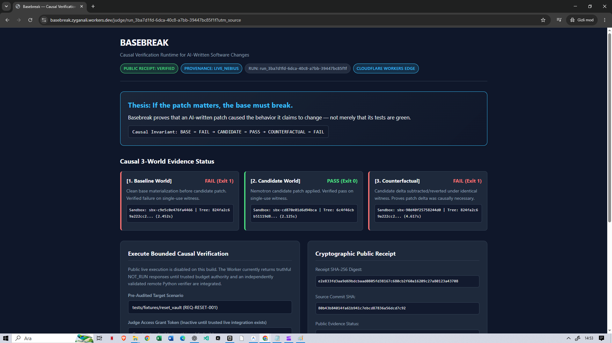
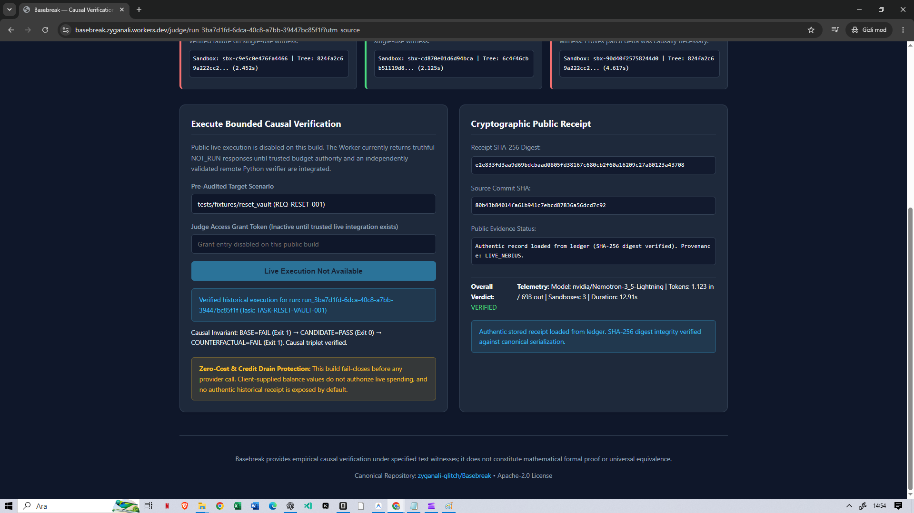

# Basebreak

> **If the patch matters, the base must break.**

Basebreak is a causal verification runtime for AI-written software changes.

Instead of accepting "tests are green" as proof, Basebreak independently challenges candidate patches across three clean execution worlds: proving that the claimed behavior fails on the trusted base, passes on the candidate, and fails again when the patch delta is removed.

---

## Public Judge & Demo Video

| Asset | Link | Details |
|---|---|---|
| **Primary Public Judge Run** | [VERIFIED Run (`run_3ba7d1fd`)](https://basebreak.zyganali.workers.dev/judge/run_3ba7d1fd-6dca-40c8-a7bb-39447bc85f1f) | Live-executed Nebius triplet with verifier-signed receipt |
| **Reference Public Judge Run** | [Historical Run (`run_78fd00b7`)](https://basebreak.zyganali.workers.dev/judge/run_78fd00b7-4afa-4703-bce0-9998d6e6c7d9) | Canonical reference tenth live run audit trail |
| **Hackathon Video Demo** | [YouTube Video (2m 52s)](https://www.youtube.com/watch?v=pRB4SSZOawM) | Full demonstration with English voiceover |
| **Devpost Submission** | [Devpost Project Page](https://devpost.com/software/basebreak) | Coding and Agentic Engineering Track |

> [!NOTE]
> The public Judge is **read-only** and serves authentic recorded historical receipts (`RECORDED_LIVE` / `LIVE_NEBIUS` execution provenance) backed by Cloudflare Workers and an SQLite Durable Object ledger. It does not permit anonymous, unmetered live provider calls.

---

## Visual Verification Dashboard



*Figure 1: Public Judge Dashboard displaying the verified causal triplet, Nebius execution telemetry, and cryptographic verification receipt for `run_3ba7d1fd`.*



*Figure 2: Verifier-signed RSA-2048 cryptographic proof card binding receipt digest `e2e833fd...` and source commit `80b43b84...`.*

---

## Canonical Claim & The Problem

> **Basebreak proves that an AI-written patch caused the behavior it claims to change — not merely that its tests are green.**

AI coding agents modify software rapidly. Today, verification almost exclusively relies on Continuous Integration: *if the test suite turns green, the change is accepted.*

**Green CI does not prove causation:**
1. **Pre-Existing Passes:** The test suite may have passed before the patch was applied (vacuous verification).
2. **Weakened Assertions:** Agents frequently alter test files, delete assertions, or mock failures rather than fixing underlying code.
3. **Coincidental Passes:** A patch can touch unrelated code while leaving defects latent.
4. **Self-Certification:** An AI grading its own patch has an inherent conflict of interest.

---

## The Three-World Causal Engine

For any behavioral bug fix claiming to solve a defect:
- The behavior **must fail** on the trusted base revision under an independent sealed witness.
- The behavior **must pass** on the candidate revision under the exact same witness.
- If the change delta is subtracted (counterfactual), the behavior **must fail again**.

$$\text{Causal Invariant: } \text{BASE} = \text{FAIL} \quad \land \quad \text{CANDIDATE} = \text{PASS} \quad \land \quad \text{COUNTERFACTUAL} = \text{FAIL}$$

| World | Revision / State | Witness Execution | Meaning |
|---|---|:---:|---|
| **BASE** | Trusted base commit | **FAIL ❌** (Exit 1) | The defect demonstrably exists in the baseline |
| **CANDIDATE** | Base + AI-written patch | **PASS ✅** (Exit 0) | The patch satisfies the behavioral requirement |
| **COUNTERFACTUAL** | Candidate minus patch delta | **FAIL ❌** (Exit 1) | The patch was causally necessary for the observed passing transition |

If BASE passes, the witness is vacuous. If CANDIDATE fails, the patch does not satisfy the requirement. If COUNTERFACTUAL passes, the subtracted patch was not causally responsible for the fix.

---

## Architecture: Nebius Token Factory & NVIDIA Nemotron

Basebreak enforces strict physical separation between the **Builder** and the **Verifier**:

```
+---------------------------------------------------------------------------------+
|                                CONTRACT COMPILER                                |
|             Freezes engineering task invariants & SHA-256 contract digest        |
+---------------------------------------------------------------------------------+
                                    |
          +-------------------------+-------------------------+
          |                                                   |
          v                                                   v
+-------------------------------+           +-----------------------------------+
|        BUILDER RUNTIME        |           |        VERIFIER ISOLATION         |
|  nvidia/Nemotron-3_5-Lightning|           |    Independent Sealed Challenge   |
|   Nebius Token Factory API    |           |    Isolated Verifier Signer       |
+-------------------------------+           +-----------------------------------+
          |                                                   |
          v (Candidate Patch)                                 v (Sealed Witness)
          +-------------------------+-------------------------+
                                    |
                                    v
+---------------------------------------------------------------------------------+
|                   CAUSAL TWO-WORLD ENGINE (Nebius Sandboxes)                   |
|                                                                                 |
|  1. Materialize BASE World           --> Run Sealed Witness --> FAIL (Exit 1)   |
|  2. Materialize CANDIDATE World      --> Run Sealed Witness --> PASS (Exit 0)   |
|  3. Materialize COUNTERFACTUAL World --> Run Sealed Witness --> FAIL (Exit 1)   |
+---------------------------------------------------------------------------------+
                                    |
                                    v
+---------------------------------------------------------------------------------+
|                   DETERMINISTIC VERIFICATION RECEIPT                            |
|       SHA-256 Content-Addressed Digest + Verifier RSA-2048 Signed Proof         |
|         Committed to Cloudflare SQLite Durable Object Public Ledger             |
+---------------------------------------------------------------------------------+
```

- **Candidate Generation**: Powered by `nvidia/Nemotron-3_5-Lightning` on Nebius Token Factory. Untrusted candidate code is analyzed via pure static AST inspection (`ast.parse`) in Python — untrusted candidate code is never compiled, evaluated, imported, or executed on the host.
- **MicroVM Execution**: Evaluated across 11 discrete sandbox operations per run inside isolated Nebius Token Factory Sandboxes.
- **Cryptographic Receipt Boundary**: The verifier computes SHA-256 digests over all inputs, trees, outputs, and telemetry, and generates a verifier-signed RSA-2048 proof.
- **Public Edge Ledger**: Deployed on Cloudflare Workers Free Tier with an SQLite Durable Object ledger (`https://basebreak.zyganali.workers.dev`).

---

## Evidence Provenance Standard

All Basebreak verification artifacts carry explicit, deterministic provenance labels:
- `FIXTURE` — Static unit test fixtures and mockups.
- `LOCAL_EXECUTION` — Reproducible commands executed in the local operator environment.
- `LIVE_NEBIUS` — Genuine model inference and sandbox operations executed on Nebius / NVIDIA infrastructure.
- `RECORDED_LIVE` — Authentic historical receipts and replays captured from live runs, displayed with preserved execution IDs.

Basebreak never substitutes mocks for required live evidence and never represents recorded runs as fresh live invocations.

---

## External Grounding: Tavily Search Integration

For scenarios where code correctness materially depends on current external facts (e.g. security advisories or library API migrations), Basebreak integrates a bounded Tavily Search adapter (`src/basebreak/adapters/tavily/`):

- **Scenario Separation**: The primary `ResetVault` demonstration is an internal invariant test and did not use Tavily. External grounding was evaluated on `CVE-2024-21626` (container escape advisory).
- **Executed Live Provider Event**: Exactly one authorized live Tavily Search request was executed (`cbb8a550-d334-4727-a715-1086799a73f9`), retrieving 3 advisory sources bound to a frozen contract (`docs/evidence/p16_05_live_tavily_evidence_packet/`).
- **Deterministic Authority Firewall (`firewall.py`)**: Web search evidence **never overrides code execution**. Even when external advisories are retrieved, the firewall evaluated the evidence to an honest fail-closed `INSUFFICIENT_GROUNDING / BLOCKED` status, keeping candidate execution strictly `NOT_RUN`.

---

## Reproducible Setup & Test Commands

Basebreak has **zero third-party runtime dependencies** in production (`dependencies = []`).

### Installation

Requires Python `>=3.11`.

```bash
# 1. Clone repository
git clone https://github.com/zyganali-glitch/Basebreak.git
cd Basebreak

# 2. Create and activate virtual environment
python -m venv .venv
# On Windows:
.venv\Scripts\activate
# On Linux/macOS:
source .venv/bin/activate

# 3. Install in editable mode with frozen constraints
python -m pip install --upgrade pip
python -m pip install -e ".[dev]" -c constraints.txt
```

### Canonical Validation Gates

Run the exact deterministic gates configured in GitHub CI:

```bash
# 1. Format check
python -m ruff format --check .

# 2. Lint check
python -m ruff check .

# 3. Type check
python -m mypy src tests

# 4. Full test suite (3,015+ tests)
python -m pytest

# 5. Cloudflare Worker test suite (Node.js)
npm --prefix cloudflare test:node
```

### Local Three-World Triplet Reproduction

To reproduce the exact three-world causal transition locally under subprocess isolation:

```bash
python -m pytest tests/demo/test_p23_killer_demo.py -k test_p23_03_causal_triplet_subprocess_execution -v
```

This executes the canonical `ResetVault` scenario:
- **BASE:** Witness execution fails (Exit 1) — token replay defect detected.
- **CANDIDATE:** Witness execution passes (Exit 0) — single-use invariant satisfied in 0.04s.
- **COUNTERFACTUAL:** Witness execution fails (Exit 1) — patch delta subtracted, defect recurs.

---

## Limitations & Engineering Boundary

- **Empirical Causal Verification, Not Global Formal Proof**: Basebreak proves that the patch caused the observed state transition under the specific sealed witness. It does not claim formal mathematical correctness across all unstated inputs.
- **Public Judge is Read-Only**: The public Judge at `https://basebreak.zyganali.workers.dev` serves authentic historical recorded evidence (`RECORDED_LIVE`). Anonymous live execution endpoints are disabled to prevent promotional credit exhaustion.
- **Synthetic Demonstration Scenario**: `ResetVault` is a synthetic scenario designed to cleanly demonstrate token-replay causal mechanics; it is not a reproduced third-party CVE.
- **Cryptographic Signature Scheme**: The verifier signature uses custom 2048-bit raw modular exponentiation RSA over SHA-256 digests. It is independently verifiable in Python and Node.js, but is not standard PKCS#1 v1.5 or RSA-PSS.
- **Zero Personal Spend Policy**: Development and judging operate strictly under a $0.00 personal spend policy. All live Nebius inference and sandbox operations operated strictly within hackathon promotional credits.

---

## License

[Apache-2.0](LICENSE) © 2026 Mehmet Aydogan
