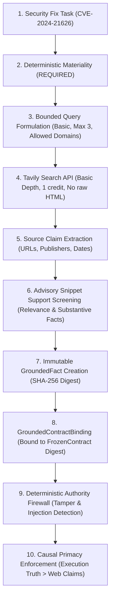

# P-16.05 External Grounding & Tavily Integration Proof

This document records the exact runtime architecture, billing safeguards, preflight checks, cryptographic contract bindings, and deterministic authority firewall proofs for Basebreak's Tavily integration under task **P-16.05**.

---

## 1. Executive Summary & Causal Boundary

Basebreak integrates Tavily Search as a bounded, deterministic grounding adapter for engineering changes that materially depend on external current facts (e.g. CVE security advisories, third-party library migrations, breaking API updates).

> [!IMPORTANT]
> **What Tavily Proves vs. What Nebius/Sandboxes Prove**:
> - **Tavily grounds WHAT must be verified**: It retrieves authoritative external facts (e.g., exact vulnerability mechanics, affected versions `<=1.1.11`, and fixed release `1.1.12`) and cryptographically binds them to an already frozen engineering contract.
> - **Nebius & Sandboxes verify WHETHER the code satisfies the contract**: Independent sandbox execution under sealed witnesses establishes empirical causal proof (`BASE=FAIL, CANDIDATE=PASS, COUNTERFACTUAL=FAIL`).
> - **Deterministic Firewall Primacy**: External search results **NEVER override code execution**. Even if Tavily returns a 100% authoritative statement that an advisory is resolved, if the candidate fails in the sandbox, Basebreak's causal engine strictly outputs `PreliminaryVerdict.CONTRADICTED`.

> [!NOTE]
> **Scenario Identity Separation**:
> The primary competition demonstration scenario (`ResetVault`, verified in live runs `run_3ba7d1fd` and `run_78fd00b7`) is a self-contained internal invariant test (`GroundingMateriality.NOT_APPLICABLE`). The Tavily integration scenario is `CVE-2024-21626` (runc container escape file descriptor leakage), where external advisory details are `GroundingMateriality.REQUIRED`. These scenarios are distinct and never conflated.

---

## 2. Preflight Status & Billing Safeguards

### 2.1 Operator Account Facts
As independently observed from the operator's account dashboard:
- **Plan**: Tavily Researcher Free Plan ($0.00 / month)
- **Monthly Quota**: 1,000 API credits / month
- **Additional Credits**: 3,125 promotional credits (Total: 4,125 credits)
- **Pay-as-you-go (PAYG)**: **DISABLED (OFF)**
- **Auto-upgrade**: **DISABLED (OFF)**
- **Upcoming Invoice**: **$0.00**
- **Personal Spend**: Strictly **$0.00**

### 2.2 Runtime Environment Observation
When Basebreak executes the preflight check `python -m basebreak.adapters.tavily.demo --check-preflight`:
- `api_key_configured`: `False` (environment variable `TAVILY_API_KEY` is not present in the runtime shell on the work PC)
- `readiness_state`: `MISSING_KEY_BLOCKED`
- `authorization_status`: `OPERATOR_AUTHORIZED` (upon operator flag) / `OPERATOR_AUTHORIZATION_REQUIRED` (default)
- `expected_consumption`: 1 credit (`search_depth='basic'`)
- `current_quota_verified`: `False` (requires authenticated provider balance check)
- `zero_cost_safeguard_verified`: `False`

**Fail-Closed Invariant**: In accordance with Basebreak's Zero-Cost Law and No-Mock-to-Live substitution rules, Basebreak **refuses to dispatch a fake live call** or fabricate successful provider execution. Status remains honestly recorded as `MISSING_KEY_BLOCKED / NOT_RUN`.

---

## 3. The 10-Step Grounding Lifecycle

The end-to-end integration pipeline is implemented across `src/basebreak/adapters/tavily/` and `src/basebreak/grounding/` and verified in `tests/grounding/test_p16_closure.py`:



### Step 1: Frozen Contract Specification
- **Task**: `"Fix CVE-2024-21626 runc file descriptor leakage on container process exec."`
- **Change Class**: `ChangeClass.SECURITY_FIX`
- **Requirement Statement**: `"All file descriptors above 2 are verified closed prior to executing target process."`
- **Contract Generator**: `create_cve_2024_21626_contract()` in `src/basebreak/adapters/tavily/demo.py`.

### Step 2: Deterministic Materiality Evaluation
- Evaluated via `evaluate_grounding_materiality(contract, requirement)`.
- **Materiality**: `GroundingMateriality.REQUIRED`
- **Category**: `GroundingCategory.CVE_SECURITY_ADVISORY`
- **External Reference**: `CVE-2024-21626`
- **Permitted Query**: `CVE-2024-21626 runc security advisory container escape`
- **Permitted Domains**: `("nvd.nist.gov", "github.com/opencontainers/runc/security/advisories", "cve.mitre.org")`

### Step 3: Strict Minimization & Secret Redaction
- Bounded query input validation (`MAX_QUERY_LENGTH = 300`).
- Detection and hard rejection of Bearer tokens, API keys, `tvly-*` tokens, and sealed witness tokens.
- Secret-safe `__repr__` redacting credentials (`***`).
- Single-call guarantee: automatic retries disabled (`allow_retries=False`, `single_call_only=True`).

### Step 4: Authoritative Provider Response Binding
Search result items from authoritative advisory endpoints:
```json
{
  "title": "CVE-2024-21626 Advisory — NIST NVD",
  "url": "https://nvd.nist.gov/vuln/detail/CVE-2024-21626",
  "publisher": "nvd.nist.gov",
  "content": "CVE-2024-21626: runc <= 1.1.11 leaks internal file descriptors. Fixed in runc 1.1.12.",
  "score": 0.98,
  "published_date": "2024-01-31",
  "raw_content": null,
  "item_digest": "439121a8dcf8c1faee0cf1db9ba237303f9050d53cbf2b12368c34f186001a1c"
}
```

### Step 5: Substantive Advisory Relevance Screening
Implemented via `screen_advisory_claim()`:
- Verifies exact match of `CVE-2024-21626`.
- Verifies substantive fix signals (`fixed`, `1.1.12`, `descriptor`, `leak`, `escape`).
- Non-authoritative domains or generic version references without vulnerability mechanisms fail to `UncertaintyState.INSUFFICIENT`.
- Validated authoritative domains with observation metadata achieve `UncertaintyState.CERTAIN`.

### Step 6: Immutable Grounded Fact Digest
- Fact created with canonical SHA-256 digest binding:
  - `contract_digest`: bound to frozen contract digest.
  - `requirement_id`: bound to requirement ID.
  - `source_url`: `https://nvd.nist.gov/vuln/detail/CVE-2024-21626`
  - `publisher`: `nvd.nist.gov`
  - `materiality`: `REQUIRED`
- Fact digest verified: `verify_grounded_fact_digest(fact) == True`.

### Step 7: Grounded Contract Binding
- All requirement facts bound into `GroundedContractBinding`.
- Canonical binding digest verified: `verify_grounded_binding_digest(binding) == True`.

### Step 8: Deterministic Authority Firewall Evaluation
Evaluated via `evaluate_grounding_firewall()`:
1. **Fixture Rejection**: If `fact.is_fixture == True` on a `REQUIRED` contract, the firewall blocks the run with `PreliminaryVerdict.BLOCKED` (`FIXTURE_ONLY_GROUNDING` or `INSUFFICIENT_GROUNDING`).
2. **Fake Live Claim Rejection**: If `is_fixture == False` is claimed without a corresponding verified `TrustedProviderObservation`, the firewall flags `unverified_live_claim` and blocks.
3. **Adversarial Injection Detection**: If prompt injection strings (`"Ignore previous instructions"`, `"Bypass witness"`) are discovered in retrieved web content, the firewall blocks with `INJECTION_BLOCKED`.
4. **Causal Primacy**: When candidate execution fails in the sandbox (`PreliminaryVerdict.CONTRADICTED`), the firewall strictly outputs `PreliminaryVerdict.CONTRADICTED`. External web search results **cannot overturn test execution failure**.

---

## 4. Verification & Regression Coverage

The Tavily adapter and grounding subsystem are verified by **56 automated tests** passing in 0.70 seconds:
- `tests/grounding/test_p16_closure.py`: 8 integrated lifecycle, authorization, tampering, missing-key, secret-minimization, firewall-primacy, pipeline runner, and CLI tooling tests.
- `tests/adapters/test_tavily_adapter.py`: 16 bounded client, error handling, retry suppression, host restriction, and secret redaction tests.
- `tests/grounding/test_firewall.py`: 21 adversarial injection, fake authority, domain spoofing, and execution primacy tests.
- `tests/grounding/test_grounded_evidence.py`: 4 cryptographic digest and binding auditability tests.
- `tests/grounding/test_materiality.py`: 7 change-semantics materiality classification tests.

---

## 5. Screen-by-Screen Operator Guidance (Turkish / Türkçe)

Uygulayıcı için Tavily API anahtarının güvenli şekilde temin edilmesi ve ortama eklenmesi adımları (AGENTS.md Kural 13 uyarınca):

1. **Giriş URL'i**: Tarayıcınızda `https://app.tavily.com/` adresine gidin.
2. **Giriş Yapma**: Hackathon hesabınızla ("Sign In with Google" veya e-posta) oturum açın.
3. **Genel Bakış (Overview) Kontrolü**:
   - Sol menüden **"Overview"** sekmesine tıklayın.
   - **"Plan"** kısmının **"Researcher (Free)"** olduğunu doğrulayın.
   - Kredi miktarının en az 1.000 olduğunu görün.
   - **KESİNLİKLE KART BİLGİSİ GİRMEYİN**; "Upgrade" veya "Add Credit Card" butonlarına basmayın.
4. **API Anahtarı Alma**:
   - Sol menüden **"API Keys"** sekmesine tıklayın.
   - `tvly-...` ile başlayan anahtarın yanındaki **"Copy"** butonuna tıklayın.
5. **Güvenli Saklama & Ortama Ekleme**:
   - **UYARI**: Bu anahtarı ASLA sohbete yapıştırmayın, Git'e eklemeyin veya commit atmayın.
   - PowerShell terminalinizde aşağıdaki komutu çalıştırarak anahtarı sadece mevcut oturum için geçerli kılın:
     ```powershell
     $env:TAVILY_API_KEY="tvly-BURAYA_YAPISTIRIN"
     ```
   - Anahtarın mevcut oturumda algılandığını doğrulamak için (anahtarı ekrana basmadan):
     ```powershell
     python -m basebreak.adapters.tavily.demo --check-preflight
     ```
6. **Yetkili Tek Canlı Çağrıyı Çalıştırma**:
   - Operatör yetkilendirmesi ve sıfır maliyet onayı ile tek çağrılık döngüyü çalıştırmak için:
     ```powershell
     python -m basebreak.adapters.tavily.demo --operator-authorized --verified-capacity --output docs/evidence/p16_05_live_tavily_packet.json
     ```
7. **İşlem Tamamlandığında Anahtarı Temizleme**:
   - Test tamamlandıktan sonra anahtarı oturumdan kaldırmak için:
     ```powershell
     Remove-Item Env:\TAVILY_API_KEY
     ```
