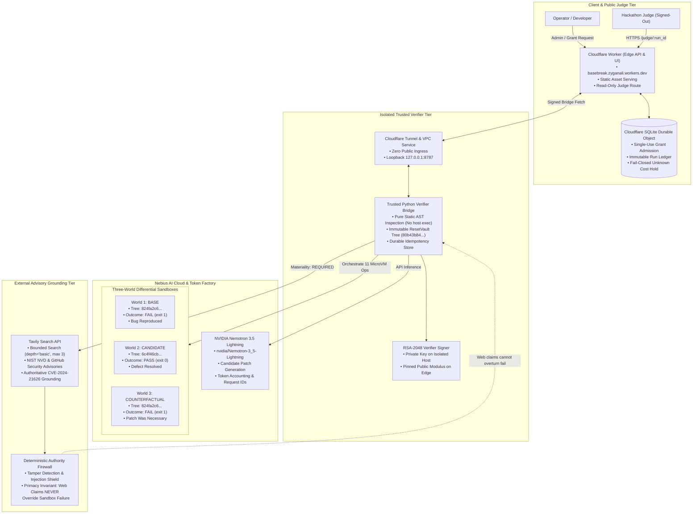

# P-30 Architecture Visual: Basebreak Causal Verification Runtime

This architectural visual documents the exact, implemented, and verified system topology of Basebreak, derived exclusively from verified code in `zyganali-glitch/Basebreak`.

---

## 1. End-to-End System Architecture

---

## 2. Component Inventory & Technical Truth

| Component | Technology | Role in Basebreak | Verified Invariant |
|---|---|---|---|
| **Candidate Generator** | `nvidia/Nemotron-3_5-Lightning` on Nebius Token Factory | Generates candidate repair code from frozen engineering contract | Prompt reinforced for full-file replacement; AST syntax and class structure verified pre-sandbox. |
| **Execution Sandboxes** | Nebius Token Factory Sandboxes (microVMs) | Provides three isolated, reproducible environments for differential execution | Zero shared mutable state; base repo materialized from immutable tree `80b43b84...`; 11 sandbox operations recorded. |
| **Verifier Bridge** | Python 3.13 stdlib (`src/basebreak/deployment/live_bridge.py`) | Orchestrates three-world verification and derives Git tree digests | Untrusted candidate code is never compiled, evaluated, imported, or executed on the host; pure static AST analysis. |
| **Verifier Signer** | RSA-2048 (Custom raw modular exponentiation) | Cryptographically signs verification receipts | Private key held only on isolated Oracle free host (`basebreak-verifier`); public modulus pinned in Worker and bridge. |
| **Edge API & UI** | Cloudflare Workers Free Tier (`cloudflare/src/`) | Serves public judge dashboard and provides tamper-proof API | Anonymous requests are strictly read-only; no unmetered live execution endpoints that drain credits. |
| **Durable Ledger** | SQLite Durable Object (`cloudflare/src/ledger.js`) | Atomically enforces single-use grants and persists immutable run receipts | Retains unknown cost on unmeasured failures; fail-closed admission hold prevents credit drain. |
| **Advisory Grounding** | Tavily Search API (`src/basebreak/adapters/tavily/`) | Retrieves authoritative CVE advisories (`CVE-2024-21626`) | Bounded query (`basic`, max 3); authoritative domain screening; strictly subordinate to execution truth. |
| **Authority Firewall** | Deterministic Firewall (`src/basebreak/grounding/firewall.py`) | Enforces execution primacy over external web claims | Injection payloads blocked (`INJECTION_BLOCKED`); web success claims never overturn witness failure (`CONTRADICTED`). |

---

## 3. The Causal Triplet Truth Table

| Execution World | Environment | State / Tree Under Test | Sealed Witness Result | Exit Code | Causal Meaning |
|---|---|---|---|---|---|
| **World 1: BASE** | Clean Nebius Sandbox microVM | Base repository (`824fa2c6...`) | **FAIL** (Token replay assertion failed) | 1 | Proves the defect was actually present before the AI change. |
| **World 2: CANDIDATE** | Fresh Nebius Sandbox microVM | AI-patched repository (`6c4f46cb...`) | **PASS** (1 test passed in 0.04s) | 0 | Proves the candidate resolved the defect under identical witness. |
| **World 3: COUNTERFACTUAL** | Fresh Nebius Sandbox microVM | Candidate with patch delta reverted (`824fa2c6...`) | **FAIL** (Token replay assertion failed) | 1 | Proves the candidate patch delta was causally necessary for the fix. |
| **OVERALL VERDICT** | Trusted Python Verifier | Combined Causal Invariant | **`VERIFIED`** | 0 | **`BASE=FAIL` and `CANDIDATE=PASS` and `COUNTERFACTUAL=FAIL`** |
